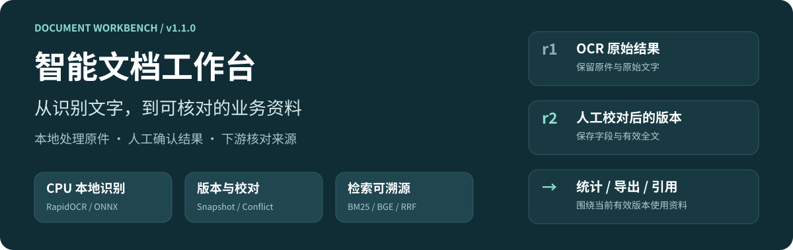
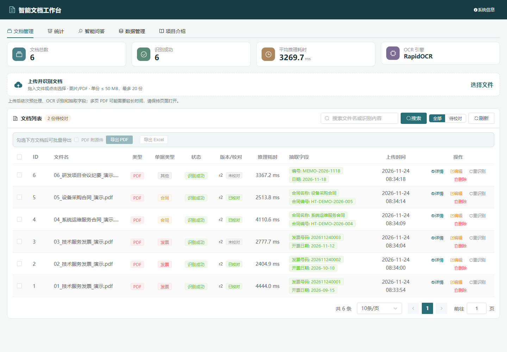
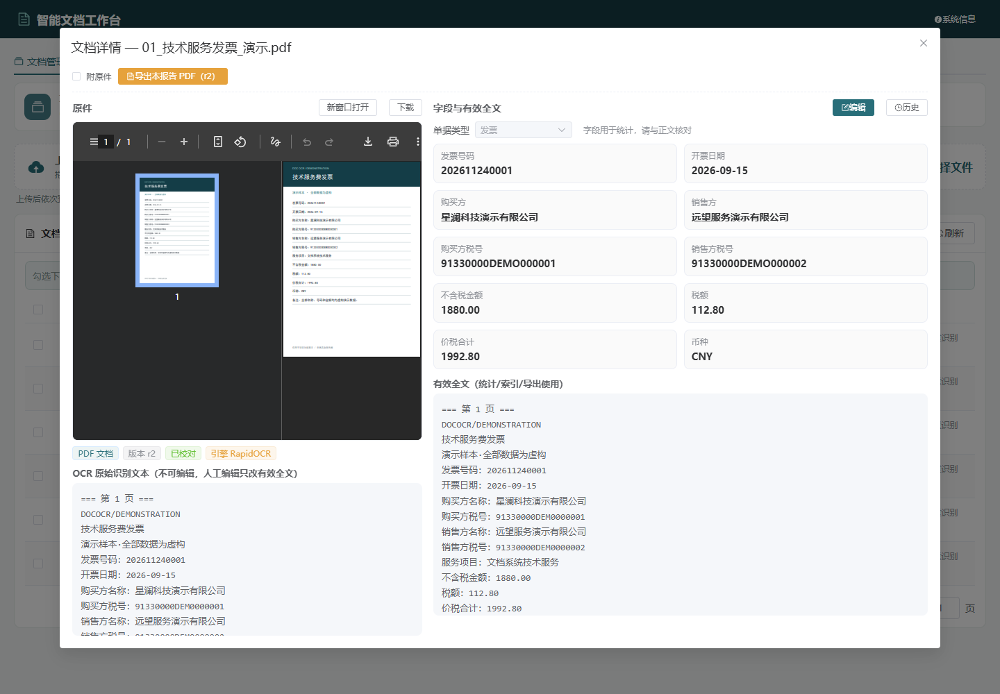
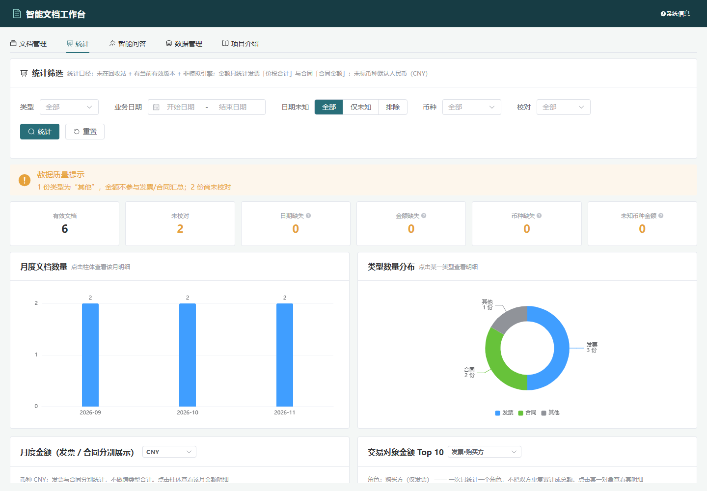
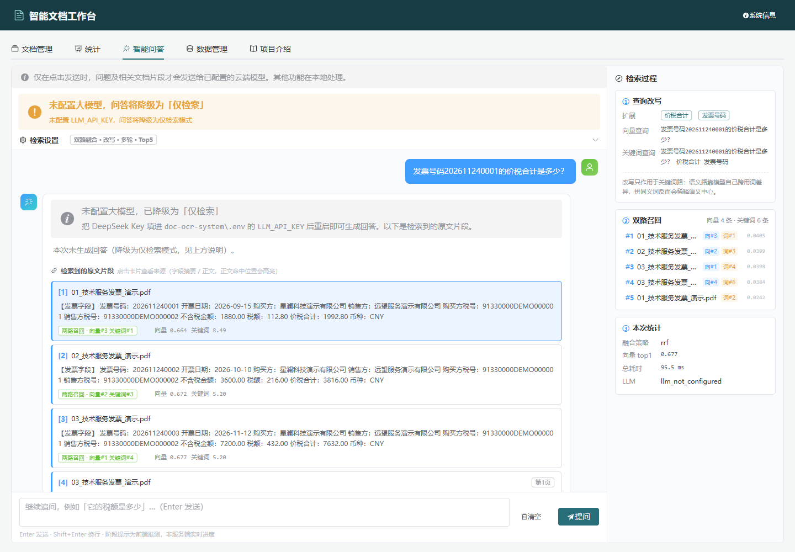
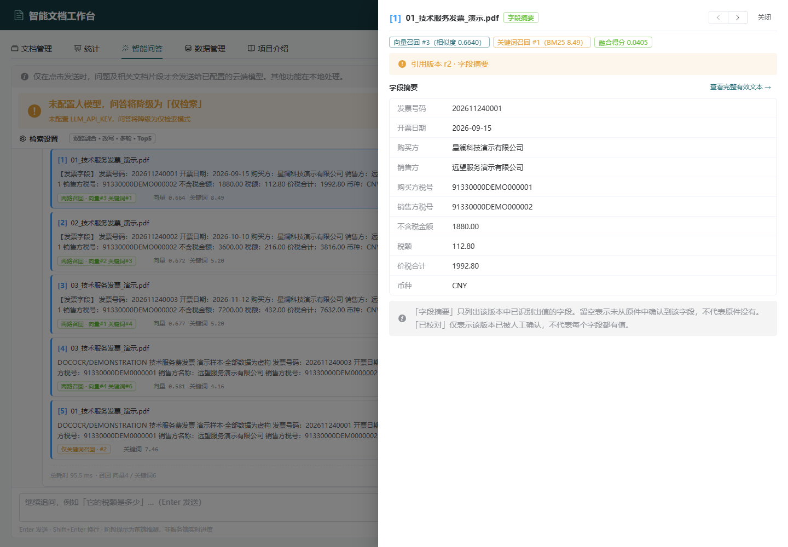
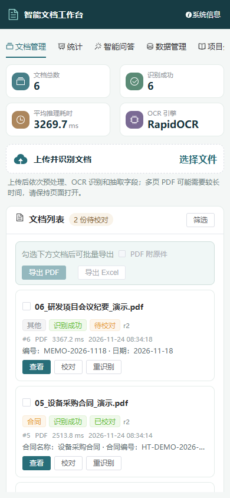
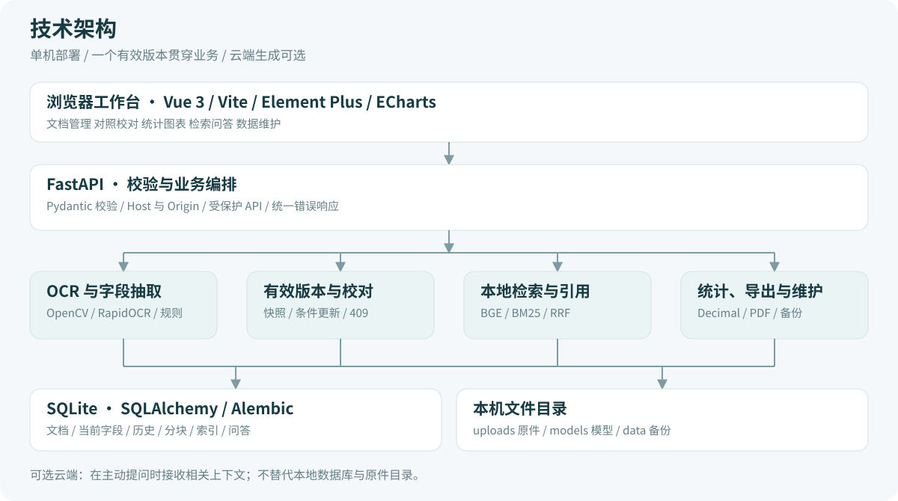
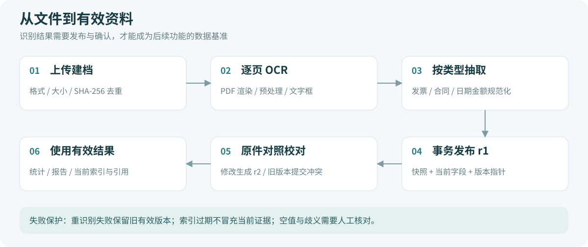

<p align="center">
  
</p>

<p align="center">
  <strong>本地 OCR · 人工校对 · 有效版本 · 统计导出 · 引用问答</strong><br />
  Python / FastAPI / Vue 3 / SQLite / RapidOCR / ONNX Runtime / BGE / BM25
</p>

<p align="center">
  <a href="#界面预览">界面预览</a> · <a href="#技术架构">技术架构</a> · <a href="#关键设计">关键设计</a> · <a href="#快速运行">快速运行</a> · <a href="docs/ENGINEERING_DESIGN_CN.md">实现与设计取舍</a>
</p>

## 项目解决什么问题

一份发票识别出了文字，并不意味着购买方、金额和日期已经正确，更不意味着这些结果可以直接参与统计或回答问题。这个项目把**“识别”之后的确认和使用流程**补齐：原件可回看，字段可校对，修改有版本，下游能核对数据来源。

适用于个人或小规模使用者在本机整理发票、合同和一般资料。上传图片或 PDF 后，系统逐页 OCR、分类抽取字段；用户对照原件确认内容，再用于统计、报告导出和文档检索。核心链路在 CPU 上运行，不要求 GPU；云端生成回答是可选能力。

**工程重点**：把现成 OCR 接成可靠的文档工作流——成功结果如何发布，失败时如何保留旧结果，旧页面如何避免覆盖新修改，检索如何排除过期版本。项目没有自行训练 OCR 模型。

> 快速阅读：先看真实界面，再看「关键设计」。需要追到代码时，阅读[实现与设计取舍](docs/ENGINEERING_DESIGN_CN.md)，其中给出了模块入口、数据关系与失败路径。

## 界面预览

以下是当前前端在**独立演示库**中的实际截图，使用虚构的公司、单据和金额。资料经过真实 RapidOCR 识别及人工校对；问答图展示本地检索与引用，不冒充云端生成效果。[截图说明](docs/assets/showcase/README.md)

### 01 / 文档管理：从上传队列到可使用的资料

支持上传队列、类型与校对状态筛选、内容去重、原件预览和批量导出。上传成功与识别成功分别表示，避免把“文件存下来了”当作“内容已经可用”。



### 02 / 对照校对：原件、字段、正文和历史版本相互可查

详情把原件和有效结果放在同一处；字段编辑与正文编辑分别保存，OCR 原始文本保留。每次实际修改生成新版本，校对状态对应具体版本。



### 03 / 统计分析：每个图表都有统一的数据口径

发票使用价税合计，合同使用合同金额，按类型和币种分别汇总。业务日期缺失单独提示，点击图表可以继续查看对应明细。



### 04 / 文档问答：先检索，再检查引用

关键词与语义两路召回，展示检索过程和来源。引用区分“正文”与“字段摘要”，可以继续查看该版本的有效全文。没有云端 Key 时保留本地检索能力。



<details>
<summary>展开查看：引用如何回到该版本的字段摘要</summary>



</details>

<details>
<summary>查看手机文档列表</summary>
<br />


手机列表采用卡片布局。此图不等同于所有手机、网络和 PDF 内嵌预览均已验收；复杂维护操作仍建议使用桌面。
</details>

## 已实现的功能

| 场景 | 能做什么 | 实现重点 |
| --- | --- | --- |
| 上传与识别 | JPG / JPEG / PNG / BMP / PDF；单份 50 MiB；本地 OCR | 分块保存、SHA-256 内容去重、PDF 逐页渲染、OpenCV 预处理 |
| 分类与抽取 | 发票 10 项、合同 9 项、其他 3 项字段 | 稳定字段键注册表；文本、位置与金额关系辅助抽取 |
| 人工校对 | 原件预览、编辑字段与全文、校对标记、历史版本 | 保留 OCR 原文，版本快照，过期版本返回 409 |
| 统计与导出 | 筛选、图表和明细；Excel、单份 PDF、批量 PDF ZIP | 统一有效集、Decimal 金额计算、固定导出快照 |
| 检索与问答 | BM25 + 本地向量；可选云端回答；引用溯源 | RRF 融合、版本过滤、正文/字段摘要分开展示、失败降级 |
| 数据保护 | 回收站、恢复、永久删除、完整备份、离线恢复 | 数据库与原件一起备份、哈希清单、恢复预检与回滚 |
| 访问与讲解 | 可选口令保护、手机布局、项目介绍和技术专题 | 后端权限与来源校验；可选 Tailscale Funnel 入口 |

其他类的“备注”主要供人工填写，不承诺自动理解任意文档。发票和合同未明确标币种时，按项目约定默认 CNY；这是业务假设，不代表原件明确写了人民币。

## 技术架构



| 层次 | 技术 | 选型与职责 |
| --- | --- | --- |
| 界面 | Vue 3、Vite、Element Plus、ECharts、Axios | 上传、列表、校对和问答组件化；图表展示后端结果 |
| 接口与业务 | Python、FastAPI、Pydantic、Uvicorn | API 校验、识别编排、版本发布、权限和错误处理 |
| 图像与 OCR | OpenCV、Pillow、PyMuPDF、RapidOCR、ONNX Runtime | PDF 逐页处理和 CPU 推理；使用现成预训练模型 |
| 业务抽取 | 正则、位置规则、字段注册表、Decimal | 按类型整理字段、规范日期金额，并检查发票合计关系 |
| 存储 | SQLite、SQLAlchemy、Alembic、原件目录 | 记录、版本与分块入库，原件保留为文件 |
| 本地检索 | BGE-small-zh-v1.5、BM25、RRF | 语义召回补充编号/术语等关键词匹配，融合后过滤版本 |
| 输出与维护 | openpyxl、PyMuPDF、ZIP、SQLite Online Backup | Excel/PDF、数据库与原件的一致性备份 |

**部署取舍**：Windows 本机、单服务进程是交付主线。SQLite 和本地模型降低部署成本；同一数据目录加单实例锁，不能据此宣称大规模多租户或高并发服务。云端模型仅在主动提问且配置可用时接收相关上下文。

## 数据工作流



1. **上传建档**：累计检查大小，计算内容哈希，保存原件；重复内容返回已有文档。
2. **逐页识别**：PDF 每次渲染一页；图像降采样、灰度化、去噪、纠偏和对比度增强后进入 RapidOCR，取得文字、文字框和耗时。
3. **整理字段**：按正文分类；发票使用 PDF 文字层或 OCR 框坐标辅助定位标签和值。文字层不替换归档的 OCR 原文。
4. **发布版本**：识别和抽取完成后，在事务中一起更新快照、当前字段和版本指针；失败不发布半套结果。
5. **对照校对**：修改发布新版本，旧页面提交过期版本返回 409。原始 OCR 与校对后的有效正文分开保留。
6. **使用资料**：统计读取当前有效快照；导出固定请求开始时取得的快照；检索只使用版本匹配的当前索引。

## 关键设计

### 1. 用“有效版本”统一各功能的数据基准

`document_info` 保存当前版本指针，`document_revision` 保存历史快照，`document_extract` 保存当前字段镜像。发票识别为 r1，人工修正后为 r2；下游围绕当前 r2 工作，r1 和原始 OCR 仍可查看。

发布采用事务和条件更新。编辑请求携带 `expected_revision`，数据库发布时再次比对旧版本及未删除状态，防止旧页面覆盖新内容，也防止识别任务重新发布已被删除的文档。

→ [版本发布](app/services/revisions.py) · [编辑接口](app/routers/document.py)

### 2. 最新尝试失败，不使上一次有效结果失效

识别先完成临时结果，成功才发布。首次失败没有有效版本；重识别失败保留原有效版本，另记最近尝试的状态和错误。页面说明“这次失败了”，下游仍可使用上一份有效内容。

→ [识别编排](app/services/recognition.py) · [逐页 PDF](app/services/pdf_handler.py)

### 3. 检索索引也需要版本检查

后台索引生成期间，文档可能再次被修改。提交前复核版本，一次事务替换分块与索引状态；查询时再排除删除文档和过期索引。索引失败可补偿，不需要重新 OCR。引用明确区分字段摘要与正文。

→ [索引编排](app/services/rag_indexer.py) · [问答管线](app/services/rag_pipeline.py) · [引用抽屉](frontend/src/components/SourceDrawer.vue)

### 4. 先统一业务含义，再画图和导出

统计、明细和导出复用有效集及字段语义。金额以 Decimal 计算，区分发票/合同和币种；不以上传日期补业务日期，不把“已校对”解释成“每个字段都有值”。

→ [统计服务](app/services/analytics.py) · [报告生成](app/services/exporter.py)

### 5. 数据保护包含原件，不只备份数据库

删除先进入回收站。备份在写入门禁内建立数据库副本，收集被引用原件并生成 SHA-256 清单；缺原件明确失败。离线恢复先校验、暂存、保留快照，再切换和迁移，失败可回滚。

→ [备份](app/services/backup.py) · [离线恢复](scripts/restore_backup.py)

## 代码阅读路线

| 想了解什么 | 建议入口 |
| --- | --- |
| 怎样把识别变成可用资料 | [识别服务](app/services/recognition.py) → [字段注册表](app/services/field_registry.py) → [发票抽取](app/services/invoice_extract.py) |
| 怎样保证编辑与下游一致 | [模型](app/models.py) → [版本服务](app/services/revisions.py) → [编辑接口](app/routers/document.py) |
| 怎样避免问答引用旧结果 | [索引](app/services/rag_indexer.py) → [检索](app/services/rag_pipeline.py) → [来源展示](frontend/src/components/SourceDrawer.vue) |
| 怎样组织前后端 | [应用入口](app/main.py) → [文档工作台](frontend/src/components/DocManager.vue) → [变化通知](frontend/src/documentEvents.js) |
| 怎样交付和保护资料 | [启动脚本](scripts/start_all.ps1) → [单实例锁](app/services/runtime_guard.py) → [恢复工具](scripts/restore_backup.py) |

详细的数据关系、RAG 工作流和失败路径见[实现与设计取舍](docs/ENGINEERING_DESIGN_CN.md)。

## 快速运行

第一次安装请阅读[新电脑安装与旧数据迁移指南](docs/NEW_COMPUTER_SETUP_CN.md)。需要 Windows、Python 3.12 或 3.13、Node.js 18+、npm 和 Git；依赖及模型下载需要网络。

```powershell
git clone https://github.com/666whatcanisay/lastStudentday.git
cd lastStudentday
py -3.12 -m venv .venv
.\.venv\Scripts\python.exe scripts\install_dependencies.py
.\.venv\Scripts\python.exe scripts\download_model.py
Push-Location frontend
npm.cmd ci
npm.cmd run build
Pop-Location
.\启动项目.bat
```

打开 <http://127.0.0.1:8000>。也可双击根目录的 `启动项目.bat`。停止时等待任务结束，再运行 `scripts\stop_all.bat`。保持单进程，不添加多 worker 或 `--reload`；Docker 不属于已验收交付方式。

**源码与运行数据分开**：仓库不包含原件、数据库、备份、模型权重、依赖、口令或 API Key，新安装列表为空是正常现象。前端构建产物也需本机生成。可使用 [`test_corpus/`](test_corpus/) 的合成 PDF 体验。

| 配置 | 是否必需 | 作用 |
| --- | --- | --- |
| OCR 依赖与本地模型 | 核心能力必需 | 由安装和模型下载脚本准备，无需训练模型 |
| `DOC_OCR_DATA_DIR` | 可选 | 未设置时用项目根目录；应指向含 `data/`、`uploads/` 的根目录，搬动项目后需核对 |
| `LLM_API_KEY` 等 | 可选 | 仅云端生成需要；无 Key 仍可 OCR、校对、统计、导出和本地检索 |
| 登录与 Funnel | 可选 | 本机默认无需口令，远程访问先启用保护；见[操作卡](docs/TAILSCALE_DEMO.md) |

自定义设置参考 [`.env.example`](.env.example)。云端问答会发送问题与相关片段，请在允许外传的资料上使用。

## 验证与边界

```powershell
.\.venv\Scripts\python.exe -m pytest -q
.\.venv\Scripts\python.exe -X utf8 scripts\verify_delivery.py --phase all
```

测试覆盖字段规范化、版本一致性、冲突、权限、检索过滤与数据保护；交付脚本使用隔离数据、独立端口并禁用真实云端 Key。部分场景会构建前端，正式页面运行时应在隔离副本执行，避免覆盖在用构建。缺少私有冻结夹具时，相关迁移/冻结检索对照会明确跳过。[历史验收记录](docs/FINAL_DELIVERY.md)按日期阅读，不代表今天的运行状态或所有样本效果。

- **准确率与模型：**没有自训练 OCR 或通用准确率、固定提速比例承诺。外币漏读、无身份标签的多名称、多组合金额仍有边界问题，重要字段需人工核对。
- **检索与生成：**引用方便检查，不保证答案正确；云端生成和纯本地检索分别说明，不混称“全部离线 AI 问答”。
- **身份与并发：**可采用一个共享口令登录即管理员，没有独立用户身份审计；单机单进程，不是企业权限或分布式系统。
- **移动端：**列表卡片适配窄屏，引用抽屉在小屏仍偏窄；桌面宽度模拟不等于所有手机真机通过。

## 进一步阅读

| 文档 | 内容 |
| --- | --- |
| [实现与设计取舍](docs/ENGINEERING_DESIGN_CN.md) | 架构、数据模型、版本和 RAG 的设计原因 |
| [通俗技术学习指南](docs/PROJECT_LEARNING_GUIDE_CN.md) | 从使用流程理解技术，准备项目讲解 |
| [新电脑安装与迁移](docs/NEW_COMPUTER_SETUP_CN.md) | 安装、模型、配置、恢复与常见问题 |
| [新旧版本差异](docs/VERSION_DIFF_V1.md) | 原有 OCR 基础与后续扩展 |
| [技术工作流](docs/TECHNICAL_WALKTHROUGH.md) | 模块与函数调用链 |
| [本机维护](docs/LOCAL_DELIVERY.md) / [接手入口](docs/HANDOVER.md) | 维护约束与历史交付背景 |

运行时的 `data/`、`uploads/`、`models/`、`reports/`、`output/` 和本机 `.env` 不进入公开仓库；本页配图仅使用独立合成资料。
