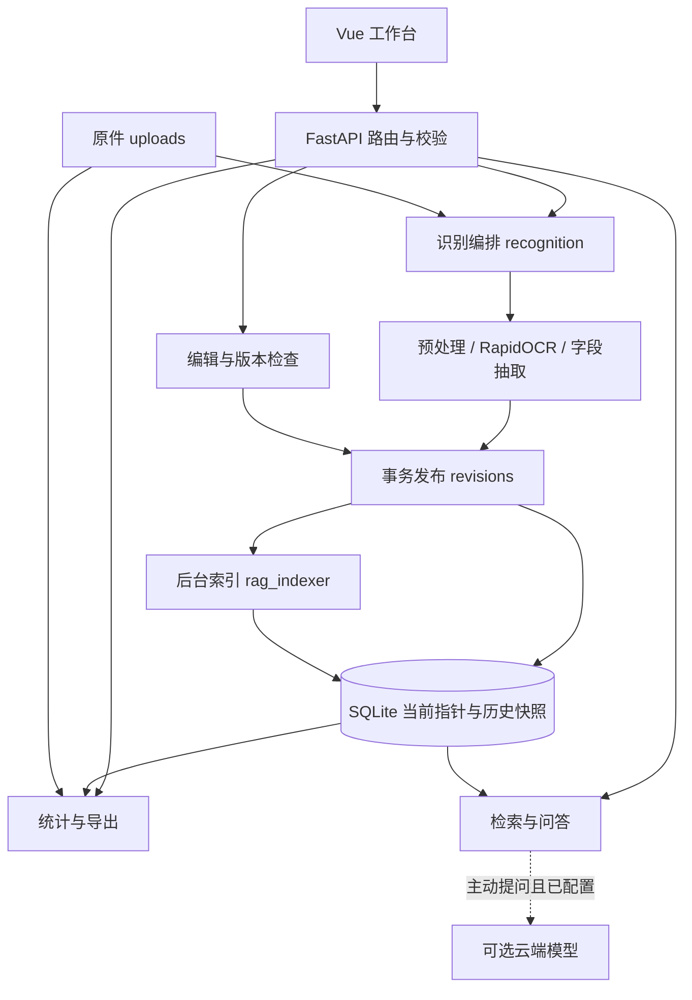
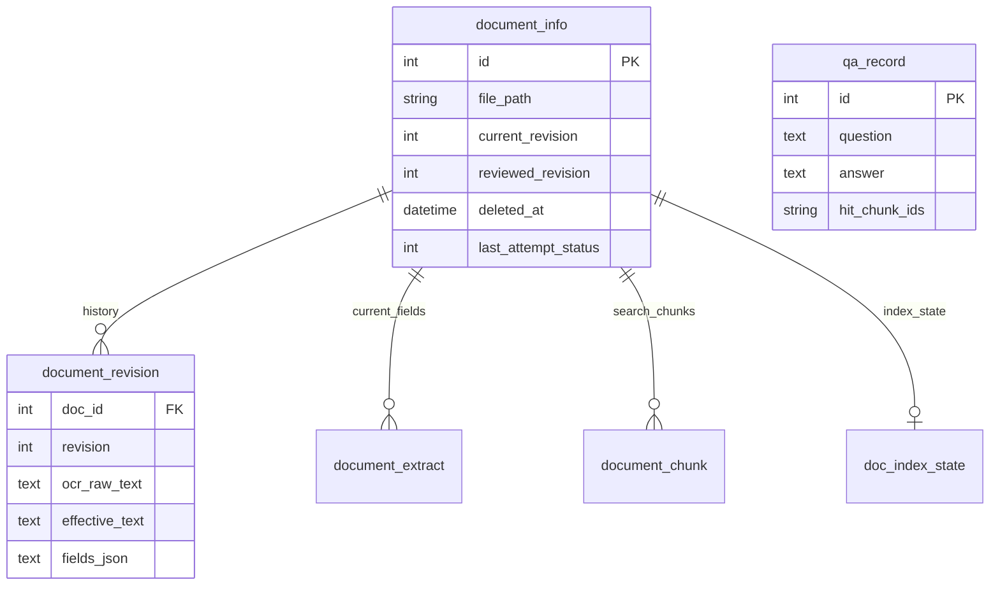
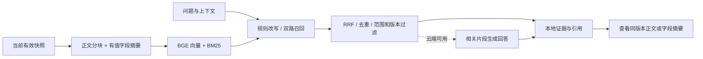

# 实现与设计取舍

这个项目把现成的本地 OCR 接成文档工作台。核心问题是：**机器读到的内容可能有错，人工修改后，统计、导出和问答怎样使用同一份有效资料？**

本文对应仓库 v1.1.0 的当前实现，说明设计、代码入口与限制，不把愿景写成性能成绩。[返回首页](../README.md)

## 1. 选型及其代价

| 决策 | 解决的问题 | 代价与边界 |
| --- | --- | --- |
| CPU + RapidOCR | 普通电脑本地识别，不依赖云 OCR | 使用现成预训练模型，受图像与版式影响 |
| FastAPI + Vue 3 | 后端统一校验，前端拆分复杂交互 | 同页领域事件刷新，不是跨用户实时推送 |
| SQLite + 原件目录 | 降低单机部署成本，原件和记录都保留 | 数据库与文件需要协调，单实例锁不是分布式锁 |
| 历史快照 + 当前指针 | 保存识别依据、历史和当前使用内容 | 需要版本与索引一致性维护，无历史版本一键回滚 |
| 规则与位置辅助抽取 | 字段候选可解释，便于人核对 | 不能覆盖所有版式，未知项和歧义要检查 |
| BM25 + BGE + RRF | 精确编号/术语匹配与语义召回互补 | 参数依赖语料，需独立样本评测 |
| 可选云端回答 | 在本地证据上组织自然语言 | 片段可能外传；缺配置/失败时降级 |

## 2. 模块关系

这些是同一应用的模块，不是微服务。FastAPI 同步路由在线程池执行；OCR 引擎单例初始化，同文档识别使用进程内锁。部署仍要求单进程，不能据此推导无限并发。[应用入口](../app/main.py) · [识别服务](../app/services/recognition.py)

## 3. OCR、抽取和校对各自负责什么

**OCR 读字，抽取整理业务字段，人工校对确认当前使用内容。**

1. 上传分块写盘、累计检查 50 MiB 上限、计算 SHA-256；重复内容返回已有记录，回收站同内容提示恢复。
2. PDF 以 200 DPI 逐页渲染，避免全部页面图像先装入列表。完整文字和结果仍需保存，并非任意大 PDF 都是常量内存。
3. OpenCV 做长边降采样、灰度化、降噪、倾斜矫正和 CLAHE。缩小输入降低像素量；去噪与纠偏会增加处理成本，不能笼统说所有预处理都提速。
4. RapidOCR/ONNX Runtime 做已有模型的本地推理，返回文字、文字框和耗时。
5. 正文规则分类为 `invoice`、`contract`、`other`；字段注册表统一稳定键、标签、规范化与编辑校验。
6. 发票用 PDF 文字层或 OCR 框辅助配对标签和值，用汇总行和金额等式辅助抽取。文字层不替换归档 OCR 原文。

| 类型 | 字段 |
| --- | --- |
| 发票 10 项 | 发票号码、日期、购销方名称、双方税号、净额、税额、价税合计、币种 |
| 合同 9 项 | 名称、编号、甲乙方、签订/生效/到期日期、金额、币种 |
| 其他 3 项 | 编号、日期、备注；备注主要由人工填写 |

空值不等于 0，默认 CNY 是业务约定。外币漏读、缺身份标签名称和多组金额候选仍有已知边界，不能把“保守抽取”目标当成所有分支均已实现。

源码：[上传](../app/routers/file.py) · [PDF](../app/services/pdf_handler.py) · [预处理](../app/services/preprocess.py) · [引擎](../app/services/ocr_engine.py) · [字段定义](../app/services/field_registry.py) · [发票规则](../app/services/invoice_extract.py)

## 4. 有效版本与数据模型

六张业务表分别保存主目录、历史版本、当前字段、检索分块、索引状态与问答记录；`alembic_version` 是技术表。`document_revision` 的 `(doc_id, revision)` 联合唯一。当前指针是业务版本号，不是快照行 ID，也不是复合外键；历史字段以 `fields_json` 为准。

`qa_record.hit_chunk_ids` 是文本，没有到文档/分块的外键。旧问答记录不能直接作为当前事实，引用需重新核查。

### 发布怎样保证一致

`publish_revision()` 在调用方的事务内：按 ID、未删除状态和旧版本条件更新指针 → 插入新快照 → 替换当前字段 → 更新类型/校对指针 → 统一提交，异常回滚。

编辑接口先查 `expected_revision`，发布时再条件更新。A、B 都读到 r1，A 保存 r2 后，B 提交 r1 返回 409。识别任务遇到已删除文档也不能重新发布。

改字段不自动改写有效全文；改全文不自动重抽字段；OCR 原文不被人工编辑覆盖。类型切换按目标类型整理字段，旧类型内容留在历史。无变化时可仅标记当前版本已校对，不制造空版本。

### 最近失败怎样保留旧结果

首次识别失败没有有效版本；重新识别失败保留旧版本，另记 `last_attempt_status/error`。最近一次失败与当前可用内容分开表达。识别耗时主要是 OCR 调用耗时，不当成上传到发布的端到端耗时。

源码：[数据模型](../app/models.py) · [版本服务](../app/services/revisions.py) · [编辑接口](../app/routers/document.py) · [识别编排](../app/services/recognition.py)

## 5. 检索怎样跟随版本

**索引期**：对 `effective_text` 分块并记录页码/偏移；有值字段另组摘要块。BGE-small-zh-v1.5 本地编码为 512 维向量，float32 二进制存入 SQLite；BM25 索引在内存构建。采用的已发布 INT8 向量模型与 OCR 模型是两回事。

后台任务使用独立 Session。生成候选分块后复核版本，一次事务替换分块和索引状态。查询时继续校验索引版本；启动补偿只补索引，不重新 OCR。

**查询期**：支持关键词、向量、混合模式和限定文档范围；显式空范围不能扩大为全库。向量模型不可用可退到 BM25；无云端配置或调用失败时返回本地证据。

**引用期**：正文有偏移才定位高亮；字段摘要没有正文偏移，必须明确标注，并可切换到同版本有效全文。引用存在方便检查，不保证答案正确。

源码：[索引](../app/services/rag_indexer.py) · [问答管线](../app/services/rag_pipeline.py) · [向量模型](../app/services/embedding.py) · [来源展示](../frontend/src/components/SourceDrawer.vue)

## 6. 统计、输出与维护

| 流程 | 一致性与失败处理 |
| --- | --- |
| 统计 | 未删除、有有效快照、非已知 Mock；筛选与明细复用同一有效集 |
| 金额 | 发票取价税合计、合同取合同金额；Decimal 计算，按类型与币种分组，不称为收入或利润 |
| 导出 | 请求开始固定快照；Excel 按类型分表并防公式注入；PDF 可附原件，缺件明确失败；批量 ZIP 保留失败清单 |
| 回收站 | 软删除保留原件历史，正常下游排除；恢复后核对索引；永久删除限定回收站和受控路径 |
| 备份 | 写入门禁协调业务，SQLite Online Backup 建副本，收集原件与回收站原件，生成哈希清单；缺件不声称完整 |
| 恢复 | 校验 ZIP/清单、暂存、停服并核验进程、锁数据根、保留快照、切换、路径重定位和迁移；失败回滚 |

数据库事务不包含文件系统事务，维护需要显式协调。WAL 运行期间不能只复制主 `.db` 就声称获得一致备份。

源码：[统计](../app/services/analytics.py) · [报告](../app/services/exporter.py) · [备份](../app/services/backup.py) · [恢复](../scripts/restore_backup.py)

## 7. 部署和当前限制

默认绑定 `127.0.0.1`。启用单口令保护后登录即管理员；口令以 PBKDF2-SHA256 加盐哈希保存，会话在内存，重启失效。校验 Host/Origin 与后端权限；共享口令不能识别具体操作人，没有独立用户审计。

可选 Funnel 将 HTTPS 请求转发到本机，不保存业务数据库或原件。云端模型接收相关上下文，不代替本地存储。移动项目后应核对数据根和原件绝对路径，按迁移流程处理。

当前适合单机演示和小规模资料整理。后续重点：非标准票据的保守抽取、独立样本评测、小屏引用阅读与共享口令可追责性。不宣称企业多租户、全面手机兼容、通用准确率或全自动业务确认。

## 8. 值得沿源码追问的问题

| 问题 | 验证入口 |
| --- | --- |
| 重识别失败是否抹掉有效版本？ | `recognition.py`，版本/失败保护用例 |
| 两个旧页面同时保存会怎样？ | `expected_revision`、发布条件更新、409 用例 |
| 索引过程中资料又修改了怎么办？ | `rag_indexer.py` 的版本复核与事务替换 |
| 图表、明细和报告为何能对上？ | `analytics.py` 的有效集与字段语义 |
| 来源到底是摘要还是正文？ | `source_kind`、字符偏移与 `SourceDrawer.vue` |
| 备份是否包括回收站原件？ | `backup.py`、恢复脚本与缺件用例 |
| 模拟云端通过能证明真实云端吗？ | 不能，本地检索、模拟传输、真实云端分别记录 |

执行入口：[`tests/`](../tests/) 与 [`verify_delivery.py`](../scripts/verify_delivery.py)。历史结果不代表今天状态；本次展示只以独立合成资料截图，没有修改业务规则或用介绍文案掩盖已知缺陷。
