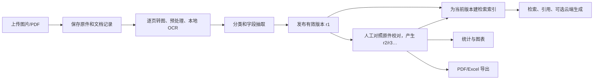

# 智能文档工作台：从零看懂项目与面试讲解

> 适用对象：曾参与项目、现在需要重新熟悉它并向面试官介绍的人。本文按当前本地源码梳理，不把历史验收数字当作今天的运行结果，也不包含真实口令、密钥或业务文档内容。第一次阅读先看第 1～3 节，再按需要查技术细节。

手机阅读：把同目录的 `PROJECT_LEARNING_GUIDE_CN.html` **这一个文件**发送到手机，保存后用手机浏览器打开即可。它内嵌样式与目录，不依赖项目服务或网络。

## 1. 先记住一句话

这是一个**把图片和 PDF 整理成可核对资料的单机工作台**：上传原件 → 本地 OCR 读字 → 提取字段 → 人工校对 → 发布有效版本 → 统计、导出和带引用的问答。

它解决的不是“OCR 读出几个字”这个孤立问题，而是读完之后**怎么确认、怎么保存、怎么复用、怎么追溯**。

可以这样记各部分的角色：

| 部分 | 大白话 | 代码/技术 |
| --- | --- | --- |
| Vue 页面 | 操作台，负责让人上传、查看、校对 | `frontend/src/App.vue`，Vue 3、Element Plus、ECharts |
| FastAPI | 调度员，接请求、检查权限、调用服务 | `app/main.py`、`app/routers/` |
| RapidOCR | 读字员，识别图片里的文字 | `app/services/ocr_engine.py`，预训练模型＋ONNX Runtime |
| 字段规则 | 填表员，从原文找日期、金额、购销方等 | `field_registry.py`、`extractor.py`、`invoice_extract.py` |
| 人工校对和版本 | 审核、留档，允许改正但不抹掉历史 | `document.py`、`revisions.py` |
| SQLite＋原件目录 | 账本＋档案袋；两者缺一不可 | `app/database.py`、`data/`、`uploads/` |
| 检索问答 | 先查资料再回答，并给出出处 | `rag_indexer.py`、`rag_pipeline.py` |

当前页面有**四个业务板块**：文档管理、统计、智能问答、数据管理；另有一个只读的“项目介绍”页签。它不是五套互不相干的系统，核心数据都是**文档的当前有效版本**。

## 2. 一份文档从头到尾经历什么

手机阅读时，先把整条线记成：**上传原件 → OCR 读字 → 抽字段 → 人工校对并留版本 → 统计 / 导出 / 问答**。下面的图只是把这条线展开。

用一张**合成发票**举例：

1. **上传**：浏览器把文件发给 `POST /api/file/upload`。后端先看格式、大小，分块写入 `uploads/`，计算 SHA-256。相同内容已有记录时不假装又上传出一份新文档。此时只是“原件已保存”，**还不是“识别成功”**。实现见 `frontend/src/components/UploadQueue.vue`、`app/routers/file.py::upload_file`。
2. **OCR**：页面再用 `doc_id` 调 `POST /api/ocr/recognize`。PDF 用 PyMuPDF 逐页渲染成图；图片经过 OpenCV 预处理，再由本机 RapidOCR 识别。它返回文字和文字框位置。实现见 `app/routers/ocr.py::recognize_document`、`app/services/recognition.py::run_recognition`。
3. **分类与抽取**：系统根据**正文**判断是发票、合同或其他，不靠文件名猜。发票按标签、位置和金额关系找候选字段。例如“价税合计”是最终金额的强证据，不能把商品明细行随便当总额。没有可靠依据就留空，交给人核对。实现见 `field_registry.py::classify_doc_type`、`extractor.py::extract_for_type`、`invoice_extract.py::extract_invoice_fields`。
4. **发布版本**：一次成功识别把 OCR 原文、可用正文、类型和字段一起发布为 `r1`。失败时不产生“假成功”；如果是重新识别失败，旧有效版本仍保留。实现见 `revisions.py::publish_revision`。
5. **人工校对**：用户一边看原件一边改字段或全文。提交时带上自己看到的版本号 `expected_revision`；若别人已先保存新版，接口返回 **409**，要求重新载入，避免覆盖别人的修改。校对产生 `r2`、`r3`，OCR 原始文本不被人工编辑覆盖。“已校对”表示确认该版本，**不等于每个字段都填满**。实现见 `frontend/src/components/DocumentDetail.vue::saveEdit`、`app/routers/document.py::patch_document`。
6. **下游使用**：统计、导出和检索读取当前有效版本；后台为新版建立索引，旧版本索引不再作为当前问答证据。删除进回收站后也不参与正常统计和问答。实现见 `analytics.py::load_valid_docs`、`document_export.py`、`rag_indexer.py::index_document`。

**理解重点**：上传文件、OCR 原文、人工确认后的内容不是同一件东西。面试时如果能讲清这三层，就已经抓住项目核心。

## 3. 文件、数据库和“有效版本”分别存什么

| 地方 | 保存什么 | 为什么这样做 |
| --- | --- | --- |
| `uploads/` | 图片/PDF 原件 | 需要回看、预览、对照和完整恢复；不能只存 OCR 字符串 |
| `data/doc_ocr_v2.db` 的 `document_info` | 文档基本信息、原件路径、状态、当前版本号 | 相当于每份文档的目录卡 |
| `document_revision` | 每次识别/人工修改的类型、原始 OCR、有效全文、字段快照 | 相当于不可随意抹掉的历史记录；当前版本由 `current_revision` 指向 |
| `document_extract` | 当前使用的一组字段 | 方便列表和业务操作读取；历史字段仍在版本快照中 |
| `document_chunk`、`doc_index_state` | 检索片段、向量和对应的已索引版本 | 问答不能拿过期版本冒充当前事实 |
| `qa_record` | 问答记录和检索信息 | 供历史查看与问题排查，不是文档真相来源 |

数据库由 SQLAlchemy 管理，结构升级走 Alembic；SQLite 开启外键、WAL 和锁等待。WAL 允许读写更好地共存，**不意味着它变成高并发分布式数据库**。应用还对同一个数据目录加单实例锁，所以应保持单进程，不要随意加多个 worker。参见 `app/database.py`、`app/models.py`、`app/services/runtime_guard.py`。

人工保存为什么要生成新版本，而不是直接改原记录？因为后面要回答三个问题：**原来 OCR 读到了什么、谁校对后的结果被当前使用、某条引用是不是已经过时**。版本机制正是这些能力的共同基础。

## 4. 技术栈：选它们是为了解决什么

| 层次 | 采用技术 | 解决的问题及取舍 |
| --- | --- | --- |
| 前端 | Vue 3、Vite、Element Plus、ECharts、Axios | 页面组件化、表单/表格交互、统计图表、请求后端；前端只展示统计结果，不自行重算财务总额 |
| 后端 | Python、FastAPI、Pydantic、Uvicorn | 把上传、识别、编辑、统计、导出、问答分成 API；数据校验和权限判断放后端 |
| 存储 | SQLite、SQLAlchemy、Alembic、文件目录 | 单机部署成本低；数据库保存结构化记录和版本，目录保存原件；不适合宣称大规模多租户 |
| 图像/PDF | OpenCV、Pillow、PyMuPDF | 图像缩放/去噪/纠偏、PDF 逐页渲染、读取有文字层的 PDF 位置信息 |
| OCR | RapidOCR、ONNX Runtime；Tesseract 可作备选 | 使用**已有预训练模型**在本机 CPU 推理；项目没有自己训练 OCR，也不能把“ONNX”直接说成“OCR 已做 INT8 量化” |
| 字段抽取 | 本地分类与正则/位置规则、Decimal | 对发票/合同的明确标签和金额做可解释抽取；规则无法覆盖所有版式，模糊项要校对 |
| 检索 | 本地 BGE 中文向量模型、BM25、RRF 融合 | 关键词找精确编号和术语，向量补语义近似；向量模型使用已发布的 ONNX INT8 版本，和 OCR 模型不是一回事 |
| 生成 | 可选 OpenAI 兼容接口的云端模型 | 有证据且配置可用时组织自然语言回答；未配置/失败时保留本地检索与引用，不把生成说成全离线 |
| 导出/保护 | openpyxl、PyMuPDF、ZIP、SQLite Online Backup API | Excel、中文 PDF、批量 ZIP、一致性备份和离线恢复 |
| 远程演示 | Tailscale Funnel | 把只监听本机的服务映射到 HTTPS 公网入口；远程浏览器不必安装 Tailscale，但必须经过项目登录 |

### “轻量化”到底体现在哪里？

项目能在 CPU 上跑，并使用已发布的轻量模型。图像预处理会把过大的图片等比缩小，降低送入 OCR 的像素量；**降噪和纠偏主要为了提高可读性，反而会增加一些处理时间**，不能笼统说“所有预处理都加速”。向量模型约 512 维，优先加载 INT8 ONNX 文件；没有本地向量模型时，检索可退到 BM25。参见 `app/services/preprocess.py`、`app/services/embedding.py`。

## 5. 统计、导出、问答各自怎样用同一份资料

### 5.1 统计：先统一口径，再画图

`GET /api/document/analytics` 先读取未删除、有有效版本、非 Mock 的文档；再按类型、业务日期、日期未知、币种和校对状态过滤。后端 `app/services/analytics.py` 用 Decimal 计算金额；发票取“价税合计”，合同取“合同金额”，其他类不混进这个财务总额；不同币种不直接相加。前端 ECharts 负责画图，点图表时再用同一套过滤条件调用明细接口。因此“图上的数”和“点开看到的文档”有可核对的关系。

特别注意：**业务日期未知就标未知**，不拿上传时间顶替；“未标币种默认 CNY”是本项目的业务假设，不是票据原件明确写了人民币。

### 5.2 导出：锁定快照再生成文件

导出接口在请求开始取当前有效版本快照，避免生成报告时文档恰好被改，出现“正文来自 r2、字段来自 r3”的混合报告。Excel 按类型分工作表；单份 PDF 可生成带字段、全文和可选原件附录的报告；批量 PDF 组成 ZIP。PDF 报告不等于原件。见 `app/routers/document_export.py`、`app/services/exporter.py`。

### 5.3 问答：先找出处，后组织语言

**建索引时**：把当前有效全文切成若干片段，并额外把有值的结构化字段组成“字段摘要”片段；对片段建立关键词和向量索引。字段摘要能帮助“这张发票金额多少”之类的问题命中字段，但它**不是完整原文**，页面可切换看该版本有效全文。见 `rag_indexer.py::build_fields_chunk`、`frontend/src/components/SourceDrawer.vue`。

**提问时**：本地规则可处理口语和上下文 → BM25 找字面匹配 → 本地向量模型找语义近似 → 融合、去重、过滤旧版本 → 有证据且云端配置可用时才把相关片段送去生成答案 → 显示引用。无命中不应硬答；云端不可用则展示检索证据。见 `rag_pipeline.py::retrieve/ask`。

这个设计叫 RAG（检索增强生成）。面试中不要说“把整个数据库交给大模型”；更准确是“先在本地检索，**可选**把少量相关片段发给模型”。主动使用云端问答时，片段可能离开本机，要遵守数据使用要求。

## 6. 关键配置：哪些要记，哪些只需会查

配置来源主要是 `app/config.py`、本机 `.env` 和 `.env.example`。**不要在简历、演示材料或仓库里写真实口令/API Key。**本表列的是代码默认值或变量用途，不代表此刻实际 `.env` 的内容。

| 配置 | 当前代码默认/作用 | 面试中怎样理解 |
| --- | --- | --- |
| `DOC_OCR_DATA_DIR` | 未设置时用项目根目录；其下有 `data/`、`uploads/` | 代码和数据可以分开；不能把值填成 `.db` 文件 |
| `OCR_ENGINE` | 默认 `rapidocr` | 真实识别引擎；不能把 Mock 成功当成真实 OCR 验收 |
| 上传限制 | `.jpg/.jpeg/.png/.bmp/.pdf`；单文件 50 MB；1 MB 分块 | 控制内存与磁盘风险，哈希用于内容去重 |
| `CHUNK_SIZE` / `CHUNK_OVERLAP` | 400 / 50 字符 | 切块方便检索，重叠防止答案正好被切断 |
| `RETRIEVE_TOP_N_VEC/BM25/TOP_K` | 两路各取 20，融合后默认取 5 | 先多找候选，再缩小交给回答层的证据量 |
| `FUSION_MODE` / `RRF_K` | `rrf` / 60；关键词权重 1.5、向量权重 1.0 | 当前票据语料更依赖编号、金额等字面证据；参数是语料相关经验值，不是普适最优 |
| `EMBED_MODEL_DIR` / `EMBED_DIM` | 项目 `models/bge-small-zh-v1.5` / 512 | 本地向量模型，优先 INT8 ONNX；缺失时降级为关键词检索 |
| `LLM_BASE_URL` / `LLM_MODEL` / `LLM_API_KEY` | 可选云端生成配置 | 没有 Key 仍可 OCR、校对、统计、导出和本地检索；Key 只放本机 `.env` |
| `LLM_USE_ENV_PROXY` | 默认 `false` | 是否读取系统代理，网络需要时再调整 |
| `DOC_OCR_DEMO_MODE` / `DOC_OCR_DEMO_PUBLIC_ORIGIN` | 开启登录保护并指定准确公网域名 | Funnel 开启前必须确认未登录读数据返回 401；不可用通配域名 |
| 口令哈希 | PBKDF2-SHA256 加盐；会话在进程内，默认有效 8 小时 | 明文不写入仓库，服务重启后会话失效；当前单口令登录即完整管理员 |

检索阈值（例如向量下限、BM25 覆盖率）也在 `app/config.py`，但**不要死背数字**。要懂它们为什么存在：小而同质的票据语料里，语义相似不一定事实正确；仅靠一个相似度阈值容易误判，所以系统结合关键词覆盖率、向量结果和引用核对。换一批文档后应重新评测参数。

### 配置到底怎样生效？

项目先看**当前进程环境变量**，再从根目录 `.env` 补充尚未设置的变量，最后使用代码默认值。因此测试可设置 `DOC_OCR_SKIP_DOTENV=1` 避免误读正式配置；日常维护也要留意终端里临时设置的变量可能覆盖 `.env`。精确加载规则见 `app/local_settings.py::load_local_environment`。Python/Node 依赖版本分别见 `requirements.txt` 与 `frontend/package-lock.json`，不要把其他电脑的 `.venv` 或 `node_modules` 当成可直接复制的交付物。

安全地检查“配没配好”，无需打印配置文件：`scripts/setup_demo_auth.py --status` 只显示登录模式和是否有哈希；`GET /api/health` 显示服务及 OCR 引擎信息；`GET /api/rag/config` 显示检索/模型的可用性。**显示“已配置”不等于真实 OCR、云端生成或异地公网已经完成当次验收**；要分别用隔离样本验证。

## 7. 启动、访问和恢复：避免演示时说错

- 当前活动项目目录：`C:\Users\27715\Desktop\doc-ocr-system-github`；旧版目录只作历史归档。根目录的 `启动项目.bat` 用自身相对路径调用脚本，**用户已取消登录后自动启动**。服务已运行时再点启动按钮，会因端口占用退出；这不是服务崩溃。
- 后端默认只监听 `127.0.0.1:8000`。前端 Vite 构建输出到 `app/static_vite/`，FastAPI 在 `/` 提供页面；前端调用相对路径 `/api`。开发环境由 Vite 把 `/api` 代理到本机 8000。**在线服务运行时直接重建前端会改动正在提供的静态文件，应安排隔离构建或维护窗口。**
- Tailscale Funnel 是反向代理：`公网 HTTPS → Funnel → 本机 127.0.0.1:8000`。访客使用普通浏览器即可访问；但当前**一个共享口令即管理员**，拿到链接和口令的人能操作全部正常文档，不能识别具体是谁。它适合当前演示/小规模使用，**不是企业级权限体系**。
- 正常删除先进回收站。完整备份 ZIP 同时含 SQLite 一致性副本、原件和哈希清单；ZIP **未加密**。恢复只通过本机停服务后的 `scripts/restore_backup.py`，没有网页在线恢复接口。只复制单个 `.db` 可能漏掉 WAL 中的数据和原件，不是完整备份。

操作说明见 `docs/LOCAL_DELIVERY.md`、`docs/TAILSCALE_DEMO.md`。是否在线、Funnel 是否开启、真实 OCR/云端是否可用，都要**现场检查**，不能拿历史报告代替当前状态。

## 8. 值得讲的亮点，以及正确的讲法

1. **闭环而非单点 OCR**：从上传到校对、统计、导出、问答都围绕一份有效版本；价值是把“不可靠的识别文本”逐步变成“可用且能追溯的资料”。
2. **版本一致性**：OCR 原文和人工确认的有效文本分开；编辑带 `expected_revision`，冲突返回 409；索引也记录版本。这样尽量避免统计、报告和问答各说各话。
3. **可解释的混合检索**：BM25 处理编号等精确词，向量补语义近似，融合后给出引用；字段摘要和正文引用分开显示。回答可以沿引用回到具体版本，而不是只看一段“AI 说的”。
4. **有原则地保留未知**：日期无依据就留空；币种默认 CNY 要明确标成业务假设；金额按币种分组。这里体现的是数据质量意识，不是“把每个格子都填满”。
5. **单机也考虑失败和恢复**：识别失败保留旧有效版本、模型不可用可降级、备份使用一致性数据库副本并校验原件，恢复有预检和回滚。不是高并发系统，但有清晰的失败边界。
6. **可演示、可交接**：桌面与手机布局、项目介绍技术专题、相对路径启动按钮、隔离数据验证和远程演示入口，降低接手与讲解成本。

### 不要夸大的地方

- 不是自研/训练 OCR 模型，也不是自研大模型；主要是**集成已有模型并完成业务工程化**。
- OCR 准确率不是 100%；非标准票据仍可能漏抽或误抽。最近只读复核发现发票币种取证和购销方兜底等边界仍值得修正，不要承诺“所有发票自动准确”。
- 生成式回答不保证事实正确；必须看引用。云端问答也不是“完全离线”。
- 不是多用户、可审计个人身份、企业级高并发系统；当前共享口令无法区分操作人。
- 历史文档数量、通过率、耗时不应直接写进简历，除非你重新取得可复核的测量记录。

## 9. 面试时怎么讲

### 30 秒版

> 我参与了一个智能文档工作台。它让用户上传图片和 PDF，在本机完成 OCR 和字段抽取，再通过人工校对形成可追溯版本。统计、PDF/Excel 导出和问答都读取当前有效版本；问答先用 BM25 和向量检索找到证据，再可选让云端模型组织回答并展示引用。项目重点不是训练模型，而是把识别结果做成可核对、可复用、可恢复的业务闭环。

### 2 分钟版：按“问题—方案—难点—边界”说

> **问题**：文档手工录入费时，OCR 虽能读字，却可能读错，直接拿来统计或问答不可靠。\
> **方案**：把原件和结构化记录分开保存；上传后逐页 OCR、按正文规则抽字段，人工可以对照原件校对。每次修改都发布一个新版本，统计、导出和检索只看当前有效版本。\
> **难点**：一是避免识别错了却悄悄覆盖正确结果，所以失败保留旧版本；二是多人改同一份资料会冲突，所以用版本号和 409 防覆盖；三是问答容易“说得像真的”，所以先混合检索、过滤旧索引，再显示引用，并允许查看字段摘要与正文。\
> **取舍**：项目选 FastAPI＋SQLite＋本地 OCR，适合单机部署和演示；云端生成可选。它不声称自动理解所有票据，也不是企业级多租户平台。

### 你本人的贡献要如实说

如果你的实际工作是需求梳理、技术方案、统筹其他 AI 编码、验收和部署，就照实表达为“**主导流程设计、拆解开发任务、制定验收标准并核验关键链路**”。不要把没有亲手实现的算法写成“我独立开发”。面试官追问“你写了哪部分代码”时，应能准确区分**你亲自完成、你指导/审核、团队或 AI 辅助完成**的内容。准备简历时再按你的真实贡献选词。

## 10. 常见追问：用大白话回答

| 面试官问 | 建议回答要点 |
| --- | --- |
| 为什么不直接把整份 PDF 扔给大模型？ | 本地 OCR、规则抽取和版本校对先建立可信资料；问答只发送检索到的相关证据片段。成本、隐私和可核对性更可控。 |
| 为什么 OCR 结果不能直接用于统计？ | OCR 是“读到了什么”，不是“业务事实已确认”。系统保存原文和有效版本，允许人工核对；未知日期不伪造。 |
| 为什么既要 BM25 又要向量？ | 编号、金额、公司名等要字面精确；口语问题可能和原文用词不同，需要语义召回。两者互补，仍需看引用。 |
| 什么是版本冲突 409？ | 我打开 r2 编辑时，别人先保存成 r3；我再提交 r2 的修改就会被拒绝，避免覆盖新内容。 |
| 为什么用 SQLite，不用 MySQL？ | 当前目标是单机、单进程、易部署；SQLite 足够且支持事务。若要多用户高并发和细粒度权限，应重新设计存储与部署。 |
| 断网还能用吗？ | 本地 OCR、校对、统计、导出、本地检索可用；下载依赖/模型和可选云端生成需要网络。 |
| 项目最需要继续改哪里？ | 提高非标准发票抽取的保守性和测试覆盖；改善共享管理员口令的可追责性；扩充独立的真实样本评测。不要把现有样本效果宣传为普遍准确率。 |

## 11. 按这个顺序重新上手，别先死啃源码

1. **第 1 轮：操作 15 分钟**。用合成样本走“上传 → 识别 → 看原件与字段 → 校对 → 看版本 → 统计 → 导出 → 问答看引用”。只记住屏幕上的业务动作。
2. **第 2 轮：画一张图**。不看本文，自己画出 `浏览器 → FastAPI → OCR/抽取 → SQLite 版本＋原件 → 统计/导出/检索`。画不出来就回看第 2～3 节。
3. **第 3 轮：读六个入口**。先看 `app/main.py`、`app/routers/file.py`、`app/services/recognition.py`、`app/services/revisions.py`、`app/services/analytics.py`、`app/services/rag_pipeline.py`；每个只回答“输入、输出、失败怎么办”，暂时不要逐行研究。
4. **第 4 轮：口头讲两遍**。先讲第 9 节的 30 秒版，再讲 2 分钟版。然后让别人按第 10 节提问；答不上来再回代码查，不要靠背术语掩盖不理解。

继续深入可读 `docs/TECHNICAL_WALKTHROUGH.md`（函数与工作流）和网页里的“项目介绍”六个技术专题。本文是**学习路线图**，不是今天服务状态或测试结果的证明。
