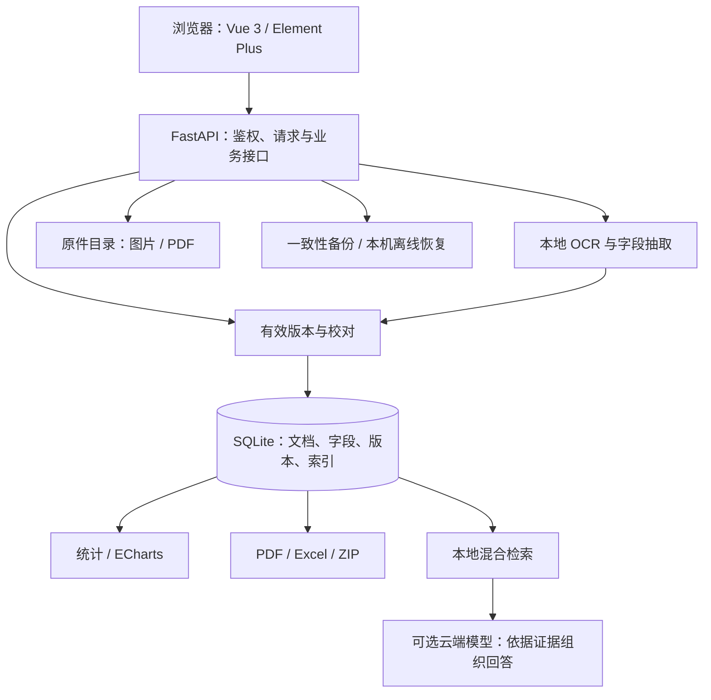
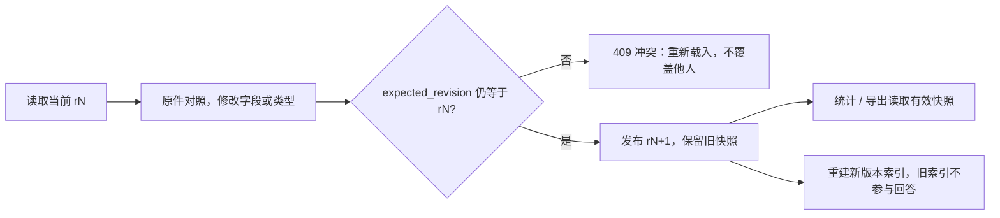
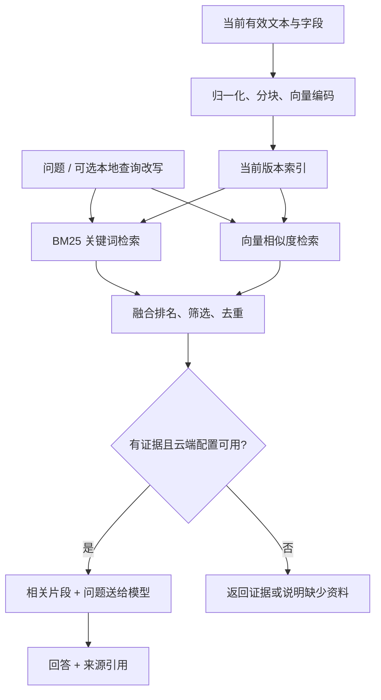

# 技术与工作流：每一步都能对应到代码

## 一、整体结构

大白话：浏览器是操作台，FastAPI 是调度员，SQLite 是账本，原件目录是档案袋，OCR 是读字工具，检索是查资料工具。账本和原件都要备份；只有数据库没有原件，项目就不完整。

## 二、上传识别链路

上传采用 FormData；单文件最大 50 MB。流式哈希判断相同内容，重复内容不伪装成新文档；旧数据没有哈希时不能假定它们已完成去重。

预处理按降采样、灰度化、降噪、倾斜矫正、对比度增强执行。降低像素规模可能减少计算量，其余步骤主要改善图像可读性，并不保证每张图更快或更准。PDF 逐页识别，因此页数越多等待可能越长。

RapidOCR 使用包内已经发布的预训练 ONNX 模型，在 CPU 上由 ONNX Runtime 推理。**本项目没有重新训练 OCR 模型，也不能仅因使用 ONNX 就宣称 OCR 全部使用 INT8。**本地向量检索另行使用已发布的 `model_int8.onnx`。两者都做本地推理，但不是同一个模型。

字段规则依据正文标签，不按文件名猜类别；金额使用 Decimal 规范化，日期转 ISO。明确字段不足时保存空值。OCR 首次失败不生成假的成功版本；重识别失败时，原有有效结果保留。

对应代码：`file.py`、`ocr.py`、`preprocess.py`、`ocr_engine.py`、`field_registry.py`、`revisions.py`。

## 三、校对、统计与导出为什么能对得上

“已校对”不等于每个字段都有值。核对过确实没有日期，仍可保留空值并标记当前版本已校对；之后再改字段会清除旧校对标记，除非同时明确选择标记新版本。

统计只计未删除、有有效版本、非 Mock 的文档。金额只汇总发票价税合计和合同金额，同币种分组，其他类来源金额不会偷偷并入财务总额。日期未知单列。

PDF/Excel 在请求开始取得版本快照，生成过程中不反复读取可能已经被别人修改的字段。Excel 分类分表，防止文本被解释成公式；批量 PDF 可部分成功，失败原因在 ZIP 清单中。原件缺失时不会悄悄生成一份声称带原件的完整报告。

对应代码：`document.py`、`revisions.py`、`analytics.py`、`document_analytics.py`、`document_export.py`、`exporter.py`。

## 四、问答链路

向量模型把句子编码成 512 维数字，用于比较语义接近程度；不是把全部文件传给云端。BM25 比较关键词匹配。RRF 等融合策略综合两路名次，不保证永远正确，仍要查看原文。

网页里显示检索过程，是让人理解答案来源，而不是单纯展示“AI 正在思考”。`/api/rag/search` 只检索，不调用云端；`/api/rag/ask` 可调用配置的云端模型。主动问答可把证据片段和上下文发出，不允许外传的文档不要使用该模式。

新版本索引未就绪时，该份暂不参加问答；删除文档后也不会继续拿旧索引回答。旧对话引用可能过时，系统不会承诺每条历史引用永久对应最新内容。

对应代码：`rag_indexer.py`、`embedding.py`、`bm25_index.py`、`fusion.py`、`rag_pipeline.py`、`routers/rag.py`。

## 五、权限和部署

| 操作 | 未登录 | 已登录（完整管理员） |
| --- | --- | --- |
| 查看原件、上传、识别、校对、统计、问答、业务导出 | 401 拒绝 | 可以 |
| 删除、回收站、恢复、永久删除、全量备份、手动索引维护 | 401 拒绝 | 可以 |
| 网页在线恢复数据库 | 没有这个接口 | 没有这个接口 |

前端隐藏按钮只是提示，后端仍校验权限。访问口令以 pbkdf2_sha256 加盐哈希保存，明文不落盘；登录会话在内存中，服务重启后失效。一个口令登录后即完整管理员，没有账号体系，也不能识别具体是哪位访问者，不是多租户系统。

普通本机模式不要求登录，只能访问 loopback；启用 Funnel 前必须启用演示鉴权并核对准确 Host/Origin。Funnel 是 HTTPS 公网入口，不是“有 Tailscale 就自动安全”。本项目只允许单进程，SQLite/数据锁不是为大规模公网并发设计的。

前端的文档变化事件只通知同一个浏览器页面中的板块；不同观众没有 WebSocket 实时推送，刷新后看到最新结果，同时编辑靠版本冲突防覆盖。

## 六、哪些话不能说

- 不说“我们训练了自己的大模型/OCR 模型”；应说集成已发布模型并完成业务流程。
- 不说“识别 100% 准确”；应说规则与人工校对共同保障质量。
- 不说“全离线 AI 回答”；应区分本地识别/检索与可选云端生成。
- 不说“所有原件都明确写了人民币”；未标币种默认 CNY 是项目业务约定，不是原件事实，明确标注的外币仍按其币种统计。
- 不说“自动理解所有合同”；目前只做有限分类、明确字段和检索。
- 不说“企业级高并发平台”；本次交付定位单机工作台与受控演讲演示。
